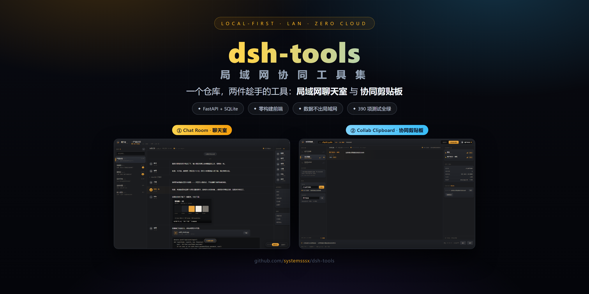
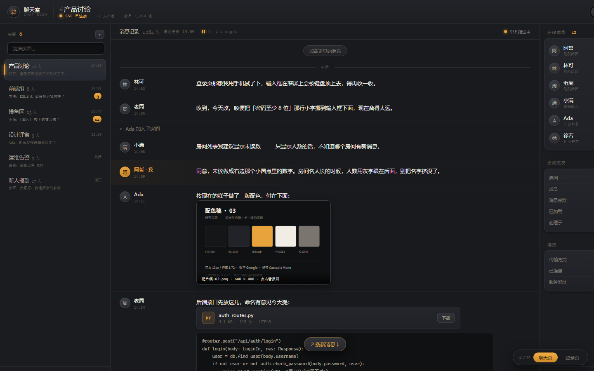
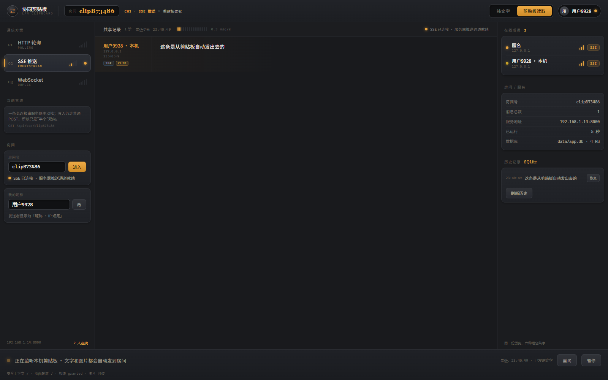
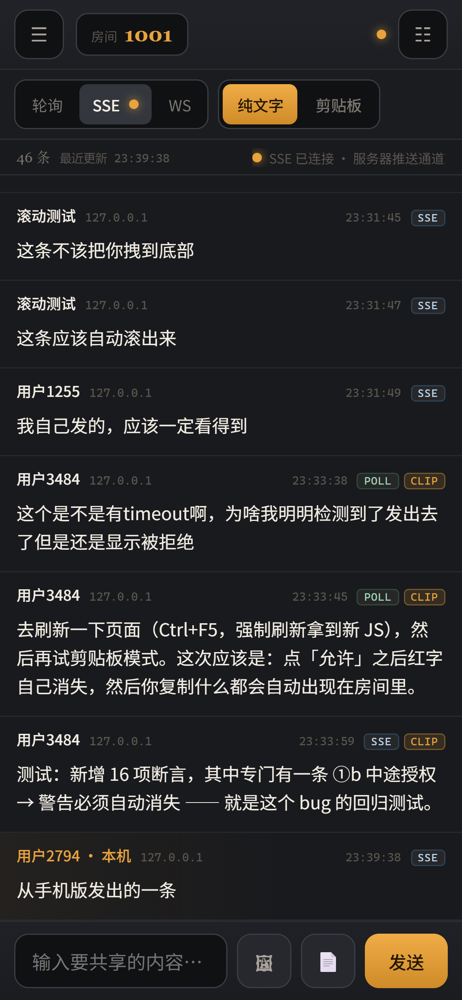
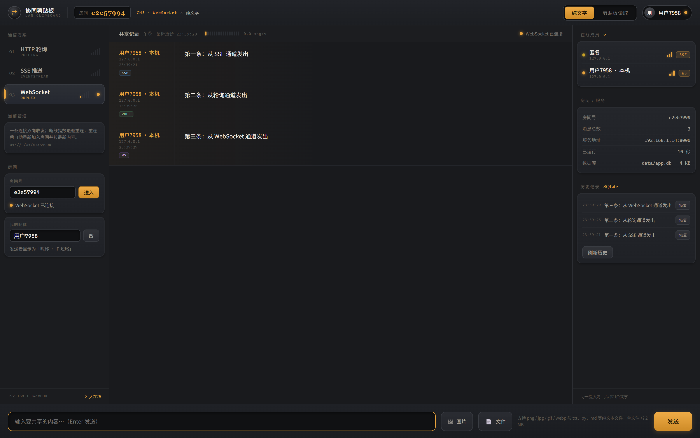

<div align="center">

# dsh-tools · 局域网协同工具集

**一个仓库，两件趁手的局域网工具：聊天室 & 协同剪贴板。**

*Two local-first LAN tools in one monorepo — chat and clipboard, no cloud, no account.*

[](./LICENSE)
[](./packages)
[](./packages)
[](./packages)
[](README.md#faq)
[](https://github.com/systemsssx/dsh-tools/stargazers)
[](https://github.com/systemsssx/dsh-tools/issues)
[](https://github.com/systemsssx/dsh-tools/discussions)



</div>

> **一句话定位**：同一个局域网里，一台电脑跑服务，手机 / 平板 / 电脑用浏览器打开就能用——内容不出内网、不需要账号、不需要外网。
> 本仓库把原来的两个独立项目合并成 monorepo：**Chat Room**（聊天室）与 **Collab Clipboard**（协同剪贴板），技术栈同源（FastAPI + SQLite + 零构建前端），一起维护。

---

## 📖 目录

- [两个子包](#sec-packages)
- [为什么合并成一个仓库](#sec-why)
- [目录结构](#sec-layout)
- [快速开始](#sec-quickstart)
- [Chat Room 聊天室](#sec-chatroom)
- [Collab Clipboard 协同剪贴板](#sec-clipboard)
- [界面截图](#sec-shots)
- [技术栈与设计原则](#sec-tech)
- [常见问题](#faq)
- [Star 支持](#sec-star)
- [交流与反馈](#sec-community)
- [贡献](#sec-contributing)
- [License & 致谢](#sec-license)

---

<a id="sec-packages"></a>

## 🧰 两个子包

| | 🗣️ **Chat Room · 聊天室** | 📋 **Collab Clipboard · 协同剪贴板** |
|---|---|---|
| 一句话 | 输入房间码就能建群聊天的局域网聊天室 | 多台设备之间共享文字、图片与文件的协同剪贴板 |
| 核心玩法 | 注册登录 → 建房 / 入房 → SSE 单连接实时推送 | 浏览器授权剪贴板 → 三种传输方式热切换 → 内容自动同步 |
| 技术 | FastAPI + SQLite + 原生 ES Module，SSE 实时通道 | FastAPI + SQLite + 零构建前端，HTTP 轮询 / SSE / WebSocket 三通道可热切 |
| 测试 | **131** 单元测试 + **51** 端到端断言 | **103** 单元测试 + **105** 端到端断言 |
| 源码 | [`packages/chatroom/`](./packages/chatroom) | [`packages/clipboard/`](./packages/clipboard) |
| 详情 | [子包 README](./packages/chatroom/README.md) | [子包 README](./packages/clipboard/README.md) |

> 两者都是从零手写的教学/实战型全栈项目：前端零构建、后端只用标准库 + FastAPI、数据全在本地 SQLite。

---

<a id="sec-why"></a>

## 🔗 为什么合并成一个仓库

1. **同源技术栈**：FastAPI + uvicorn + SQLite + 原生前端，共享同一套启动方式、测试跑法与局域网玩法；
2. **一个入口**：想用哪个就进哪个子目录，不用在两个仓库之间来回跳；
3. **一起维护**：Issue / Discussion / Star 集中在一处，两个子包的改动可以放同一个 PR；
4. **历史不丢**：原仓库 [`chat-room`](https://github.com/systemsssx/chat-room) 与 [`collab-clipboard`](https://github.com/systemsssx/collab-clipboard) 已归档只读，完整提交历史仍保留在原仓库。

---

<a id="sec-layout"></a>

## 📁 目录结构

```text
dsh-tools/
├─ packages/
│  ├─ chatroom/                 # 局域网聊天室（完整可运行）
│  │  ├─ app/                   # 后端：路由 / 存储 / SSE / 鉴权
│  │  ├─ public/                # 前端：原生 ES Module，零构建
│  │  ├─ tests/                 # 131 个单元测试
│  │  ├─ dev/                   # ui-check / e2e-check 等自检脚本
│  │  └─ README.md              # 子包完整文档
│  └─ clipboard/                # 协同剪贴板（完整可运行）
│     ├─ app/                   # 后端：三种传输 + 剪贴板接口
│     ├─ public/                # 前端：零构建
│     ├─ tests/                 # 103 个单元测试
│     ├─ design/shots/          # 真实界面截图
│     └─ README.md              # 子包完整文档
├─ docs/images/                 # 顶层 README 用的截图与 Hero
├─ CONTRIBUTING.md
├─ LICENSE                      # MIT
└─ README.md
```

---

<a id="sec-quickstart"></a>

## 🚀 快速开始

### 前置条件

| 依赖 | 要求 |
|---|---|
| Python | **3.10+**（安装时勾选 "Add python.exe to PATH"） |
| 浏览器 | 任意现代浏览器（Chrome / Edge / Safari / Firefox） |
| 网络 | 同一个局域网（手机连同一个 Wi-Fi 即可访问） |

```bash
git clone https://github.com/systemsssx/dsh-tools.git
cd dsh-tools
```

### 启动 Chat Room（默认端口 8000）

```bash
cd packages/chatroom
python -m pip install -r requirements.txt
python -u server.py --open
```

浏览器自动打开后注册账号 → 建房拿到 6 位房间码 → 手机 / 同事用同一地址 + 房间码入群。

### 启动 Collab Clipboard（默认端口 8000）

```bash
cd packages/clipboard
python -m pip install -r requirements.txt
python -u server.py --open
```

> 两个子包默认都监听 `8000`，**不要同时启动**；需要同时跑就给其中一个加端口参数（见各自 README）。

### 跑测试

```bash
# Chat Room：131 个单元测试
cd packages/chatroom && python -m unittest discover

# Collab Clipboard：103 个单元测试
cd packages/clipboard && python -m unittest discover

# 端到端（需先启动对应服务）
python dev/e2e-check.py
```

Windows 用户也可以直接双击子包里的 `启动服务.cmd` / `跑单元测试.cmd` / `放行防火墙.cmd`。

---

<a id="sec-chatroom"></a>

## 🗣️ Chat Room · 聊天室

- **注册登录**：服务端 Cookie 会话 + PBKDF2 密码哈希，登录态不落明文；
- **房间码建群**：建房生成 6 位房间码，把码发给同事即可入群；
- **实时消息**：一条 SSE 长连接推送，消息记录落 SQLite，在线成员实时刷新；
- **行级隔离**：房间之间靠成员表 + 每次访问先验成员做隔离，不串房；
- **零构建前端**：原生 ES Module，改一行刷新就好。

完整玩法、接口契约与设计记录见 [`packages/chatroom/README.md`](./packages/chatroom/README.md)。

---

<a id="sec-clipboard"></a>

## 📋 Collab Clipboard · 协同剪贴板

- **多端共享**：任意设备复制 → 局域网内其他设备看到；
- **三种传输**：HTTP 轮询 / SSE / WebSocket 均实现一遍，**可随时热切换且不丢帧**；
- **图片 & 文件**：文字、图片、纯文本文件都能互传，上传内容本地落库；
- **浏览器剪贴板**：读取本机剪贴板（需授权），也支持回写；
- **移动端适配**：手机浏览器同样能用，抽屉式布局。

完整玩法、能力矩阵与设计记录见 [`packages/clipboard/README.md`](./packages/clipboard/README.md)。

---

<a id="sec-shots"></a>

## 📸 界面截图

<div align="center">
  
  <br />
  <sub><b>Chat Room</b>：左侧房间列表 + 中间消息流 + 右侧在线成员，SSE 实时推送（设计稿渲染）</sub>
</div>

<br />

<div align="center">
  
  <br />
  <sub><b>Collab Clipboard</b>：左侧传输方式（轮询 / SSE / WebSocket）与房间控制，右侧房间信息与历史</sub>
</div>

<br />

| 手机端（剪贴板） | 端到端联调 |
|---|---|
|  |  |

---

<a id="sec-tech"></a>

## 🧱 技术栈与设计原则

| 维度 | 选择 | 为什么 |
|---|---|---|
| 后端 | FastAPI + uvicorn | 类型化、自带 OpenAPI 文档、异步原生支持 SSE/WS |
| 存储 | SQLite（Python 标准库 `sqlite3`） | 单机零配置，数据就是一个文件，备份=复制 |
| 前端 | 原生 ES Module，零构建 | 改一行刷新就能验证，没有打包链的负担 |
| 实时 | SSE 为主，WebSocket / 轮询可切换 | 不同场景各有取舍，能切换才看得见差别 |
| 部署 | 单进程 + 局域网直连 | 不需要 Docker / Nginx / 云主机 |
| 隐私 | 全本地、无外网请求、无第三方统计 | 数据不出局域网 |

> 安全性说明：这两个项目面向**可信局域网**（家用 / 教室 / 小团队），没有 TLS、没有多租户隔离，
> **不要直接暴露到公网**；需要公网访问请自行加反向代理 + HTTPS。

---

<a id="faq"></a>

## ❓ 常见问题

<details>
<summary><b>手机打不开 / 一直转圈？</b></summary>

1. 手机和电脑必须在同一 Wi-Fi；
2. 用电脑的局域网 IP 访问（服务启动时会打印，例如 `http://192.168.1.14:8000`），不要用 `127.0.0.1`；
3. Windows 首次运行请右键管理员执行 `放行防火墙.cmd`。
</details>

<details>
<summary><b>端口 8000 被占用了？</b></summary>

两个子包默认都用 8000。改端口：看各子包 README 里的启动参数（`server.py --port 8001`），
或直接改 `server.py` 顶部的默认端口常量。
</details>

<details>
<summary><b>数据存在哪里？换电脑怎么迁移？</b></summary>

各子包的 SQLite 文件在 `app/data/` 下（详见子包 README 与 `.gitignore` 规则）。
迁移 = 拷贝整个项目目录（含 `data/`）；这些运行时数据已在 `.gitignore` 中，不会进 Git。
</details>

<details>
<summary><b>剪贴板读取被浏览器拒绝？</b></summary>

浏览器剪贴板 API 只在 **HTTPS 或 localhost** 下可用；局域网 IP 访问时需要：
Chrome/Edge 地址栏 `chrome://flags/#unsafely-treat-insecure-origin-as-secure`，把 `http://<局域网IP>:8000` 加进去。
项目里也提供了降级方案（手动复制 / 上传文件）。
</details>

<details>
<summary><b>和原来的两个仓库是什么关系？</b></summary>

本仓库是 `chat-room` + `collab-clipboard` 的合并版；原仓库已归档只读，不再更新，Issue/PR 请提到本仓库。
</details>

---

<a id="sec-star"></a>

## ⭐ Star 支持

<div align="center">

**如果这两个小工具帮你在局域网里省了事——**

**点个 ⭐ Star，就是继续完善最直接的动力。**

[](https://github.com/systemsssx/dsh-tools/stargazers)
&nbsp;
[](https://github.com/systemsssx/dsh-tools/fork)

</div>

---

<a id="sec-community"></a>

## 💬 交流与反馈

| 我想… | 去哪儿 | 请带上 |
|---|---|---|
| ❓ 提问 / 讨论玩法 | **[Discussions](https://github.com/systemsssx/dsh-tools/discussions)** | 你的使用场景（局域网 / 设备数） |
| 🐛 报 Bug | **[Issues · Bug](https://github.com/systemsssx/dsh-tools/issues/new?template=bug_report.md)** | Python 版本、OS、复现步骤、报错日志 |
| 💡 提需求 | **[Issues · Feature](https://github.com/systemsssx/dsh-tools/issues/new?template=feature_request.md)** | 使用场景 + 现在卡在哪 |
| 🛠️ 提 PR | **[Pull Request](https://github.com/systemsssx/dsh-tools/compare)** | 改动说明 + 对应子包的 `unittest` 输出 |

> 发帖别贴 token / 真实绝对路径 / 用户名，用 `<本机路径>` 占位即可。

---

<a id="sec-contributing"></a>

## 🤝 贡献

```bash
git clone https://github.com/systemsssx/dsh-tools.git
cd dsh-tools/packages/<chatroom|clipboard>
python -m unittest discover      # 必须全绿
```

- Python 代码保持 3.10+ 兼容，不引入重量级依赖；后端只用 FastAPI + 标准库；
- 前端保持**零构建**：原生 ES Module，不引打包器；
- 不要提交 `data/`、`*.db`、`.venv/`、`__pycache__/`；
- 提交信息用 Conventional Commits（`feat:` / `fix:` / `docs:` / `test:`）。

完整规范见 [`CONTRIBUTING.md`](./CONTRIBUTING.md)。

---

<a id="sec-license"></a>

## 📄 License & 致谢

[MIT License](./LICENSE) © 2026 systemsssx

两个子包分别来自 [`systemsssx/chat-room`](https://github.com/systemsssx/chat-room) 与
[`systemsssx/collab-clipboard`](https://github.com/systemsssx/collab-clipboard)（均已归档只读）。
感谢所有提过意见的人。

<div align="center">
<br />
<sub>Keep it local. Keep it simple. 📡</sub>
</div>
